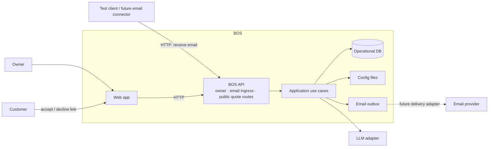
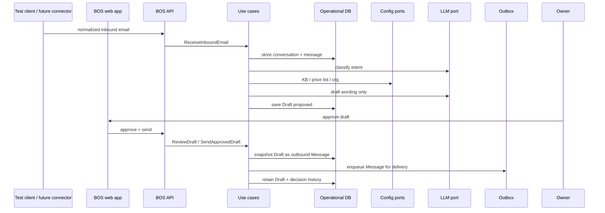
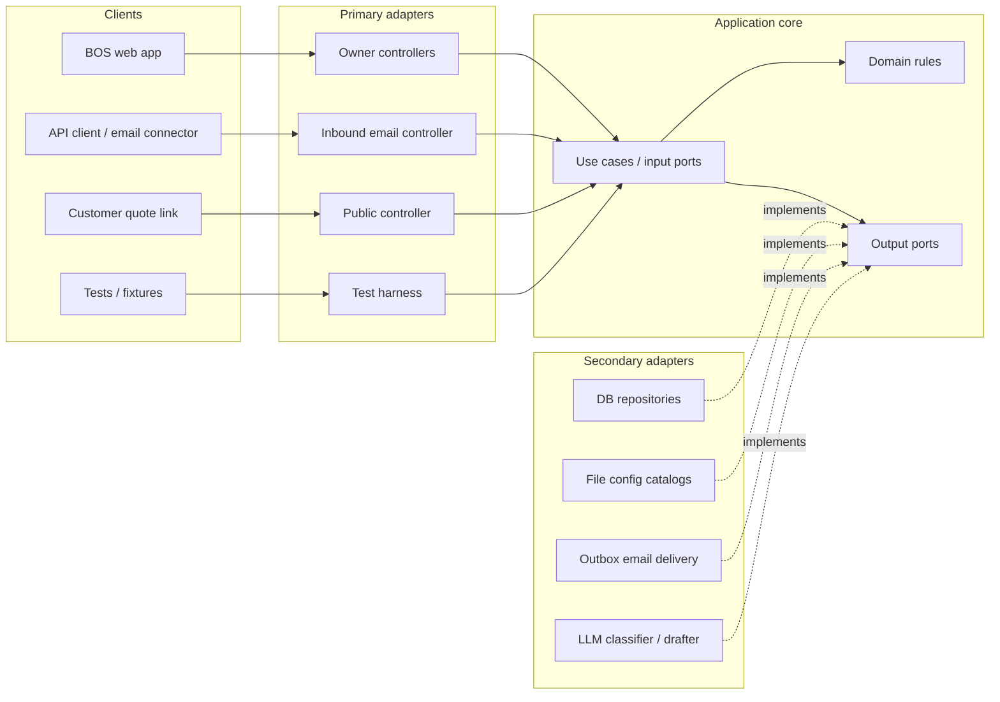

# BOS — Architecture (one page)

**Company:** OwnStack · **Product:** BOS (v3)

Companion to [`PRODUCT.md`](./PRODUCT.md). Product = *what/why*. This file = *how* (structure + scenarios). **Edit this page in git; do not fork into a diagram tool or wiki.**

## How we track architecture (decision)

| Option | Verdict |
| --- | --- |
| UML suite (class/seq in a tool) | Reject — high ceremony, rots, poor git diff |
| Separate scenario docs + architecture docs | Reject — drift |
| Full arc42 / many ADRs day one | Reject — overweight for v3 |
| Code-only (no doc) | Reject — hard onboarding; scenarios invisible |
| **One living Markdown doc + Mermaid, next to PRODUCT** | **Adopt** |

**Practice:** one `ARCHITECTURE.md`. Prose for rules, tables for ports/storage, Mermaid only where a picture beats text (context + core loops). Add `docs/adr/N-title.md` only when a decision needs lasting rationale. OpenAPI later for HTTP shapes. Diagrams never leave the repo.

---

## System context and containers



The **BOS API is the only production entry point into the core**. It contains three controller groups:

- **Owner:** inbox, threads, drafts, approve/edit/send, outbox
- **Email ingress:** receive one normalized inbound email
- **Public:** quote accept/decline

The web app always calls this API; it does not call use cases directly. For now, tests or an API client supply inbound email; approved outbound messages are recorded and visualized in the outbox. Future email connectors use the same ingress and delivery boundaries.

---

## Scenarios (product loops → use cases)

### S1 — Email lands
1. Caller submits normalized inbound mail → `ReceiveInboundEmail`
2. Upsert contact/conversation; store message
3. Visible in inbox (`ListInbox` / `GetThread`)

### S2 — Classify + draft
1. `ClassifyMessage` → lane (`quote|faq|service|complaint|quote_reply|other|noise`)
2. `PrepareDraft` for that lane  
   - FAQ: facts only from KB port; unknown → say so  
   - Quote: prices only from price-list pure rules; gaps → listed assumptions; AI writes cover only  
   - Complaint: escalate; optional draft; never auto-send  
   - Service: capture intent/next action for owner  
   - Other/noise: store/flag; no commercial invention
3. Draft status `proposed`

### S3 — Owner decides and sends
1. Owner reviews on phone-friendly UI → `ReviewDraft` (edit / approve / discard / take over)
2. `SendApprovedDraft` snapshots the approved draft into a new immutable outbound `Message` linked by `sourceDraftId`
3. Message and outbox entry are created together; **outbox visualization now**, provider delivery later
4. Draft remains for audit—it does not become or get replaced by the message
5. Delivery state belongs to the outbound message/outbox (`queued|sent|failed`) and the full history is retained

### S4 — Quote outcome
1. Customer opens accept/decline link → `RecordQuoteDecision`
2. Quote `accepted|declined`; acceptance ≠ payment ≠ job booked



---

## Hexagonal shape (lite)



Dependencies point **in**. Domain/application never import HTTP, ORM, filesystem, or vendor SDKs.

### Use cases
`ReceiveInboundEmail` · `ListInbox` · `GetThread` · `ClassifyMessage` · `PrepareDraft` · `ReviewDraft` · `SendApprovedDraft` · `RecordQuoteDecision` · `ListOutbox`

### Ports (driven)
| Port | Responsibility | v3 adapter | Later |
| --- | --- | --- | --- |
| `ConversationRepository` / `MessageRepository` / `DraftRepository` | operational state | Postgres (or SQLite) | same |
| `OrganizationDirectory` | org profile | YAML/JSON file | DB |
| `KnowledgeBaseCatalog` | FAQ facts | YAML/JSON file | DB |
| `PriceListCatalog` | catalog + inputs for pricing | YAML/JSON file | DB |
| `EmailDeliveryPort` | send outbound | Outbox recorder + UI | Gmail/SES/Resend |
| `ClassifierPort` / `DrafterPort` | intent + wording | LLM or fake | same |
| `Clock` / `IdGenerator` | time/ids | system | same |

### Domain (minimal)
| Concept | Why it exists |
| --- | --- |
| `Conversation`, `Message` | thread + immutable inbound/outbound history; outbound message references its source draft |
| `Draft` (+ status) | editable proposal and approval gate; retained after its content is copied into an outbound message |
| `Quote` (or draft payload until accept-link needs it) | accept/decline; commercial yes/no |
| `MessageLane` | routing |
| Pure `buildQuote(priceList, request)` | **AI never sets price** |
| KB lookup result → draft | **AI never invents facts** |

Not domain: Gmail types, Prisma rows, HTTP requests, prompt strings as business API.

---

## Storage split

| Dynamic (DB) | Static-for-now (files behind ports) |
| --- | --- |
| conversations, messages, drafts, decisions/audit | `org.yaml` |
| email_outbox | `knowledge-base.yaml` |
| quote records when accept-link needs stable ids | `price-list.yaml` |

Swap file adapters for DB adapters without changing use cases. Do not dual-write files and DB.

---

## Hard rules (enforced in core)

1. Prices only from price list / pure pricing — not the model.  
2. FAQ substance only from KB — else explicit unknown.  
3. No binding send without approval (`Draft` must be approved).  
4. Missing quote facts → assumptions, not silent fill.  
5. Accept ≠ pay ≠ booked.  
6. Complaints → human; never auto-send.

---

## Folder map

```text
src/domain/                  # few types + pure pricing
src/application/ports/
src/application/use-cases/
src/adapters/primary/http/
src/adapters/secondary/persistence/
src/adapters/secondary/config-files/
src/adapters/secondary/email/    # outbox
src/adapters/secondary/ai/
src/infrastructure/              # composition root, db
config/                          # org, kb, price-list
docs/PRODUCT.md
docs/ARCHITECTURE.md             # this file
```

---

## Test strategy

- **Domain:** draft transitions, pricing/assumptions  
- **Use cases:** in-memory repos + file or stub catalogs + recording outbox (no network)  
- **Adapters:** file load/map; DB integration as needed  
- **Golden path:** inbound fixture → classify → draft → approve → outbound message + outbox row

---

## Non-goals (architecture)

Microservices · workflow engines · multi-tenant agency · live mailbox as domain · dual config stores · UML model browser · fat entity model for pure CRUD  

---

## Build order

1. DB + `ReceiveInboundEmail` + inbox reads  
2. Outbox delivery + `SendApprovedDraft` (manual/approved path)  
3. File config ports (org, KB, prices)  
4. Classify + FAQ draft lane  
5. Quote lane + pure pricing + accept/decline  
6. Service capture + complaint escalate  
7. Real email connector adapters (in + out) only after core loops are solid  

---

*Living doc: change with the system. Prefer updating this page over adding parallel architecture docs.*
