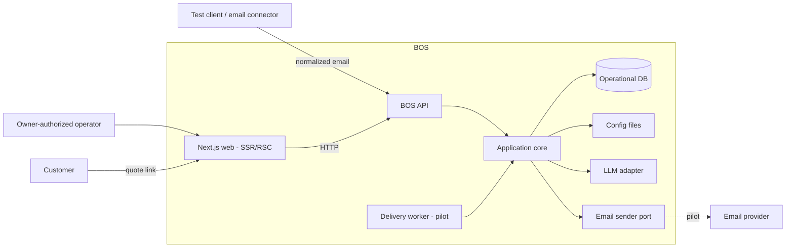
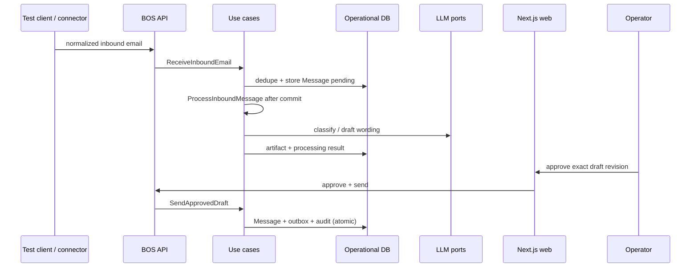
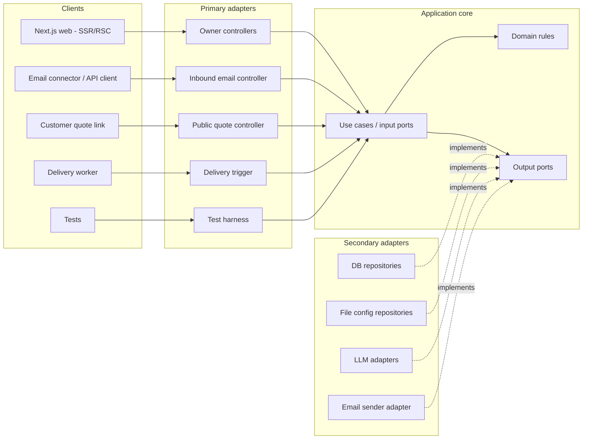

# BOS — Architecture

**Company:** OwnStack · **Product:** BOS (v3)

Companion to [`PRODUCT.md`](./PRODUCT.md): product = *what/why*; this file = *how*. Stack and delivery choices live in [`DECISIONS.md`](./DECISIONS.md). This is the living source of truth for boundaries and behavior. Keep diagrams in Mermaid and decisions in git; use an ADR only when historical rationale must be retained.

## Milestones

| Milestone | Includes | Excludes |
| --- | --- | --- |
| **Core demonstrator** | authenticated operator, normalized email API, file-managed config, complete core workflows, outbox visualization, quote-decision contract tests | live mailbox and delivery |
| **Pilot** | demonstrator + one real mailbox connector, real delivery, complaint workflow, quote links, backup/recovery | multi-org, complex roles, config admin UI |

File config is owner-controlled but maintained outside the UI initially. Connectors are built after the core loops but **before** the product is called pilot-ready.

## System context



The web app is a **Next.js** UI (App Router, SSR/RSC). It always calls the BOS API over HTTP—including from Server Components, Server Actions, and any thin BFF/proxy routes. It never imports core, repositories, or adapters and never hosts domain rules. API controller groups live only on the backend: **owner** (inbox, drafts, approval, outbox), **inbound email**, and **public quote**. A pilot delivery worker is another primary adapter that invokes `DeliverQueuedEmail`; external systems never access repositories directly.

Next.js may improve cookie/session UX and server-render owner screens or the public quote page; authorization still belongs to the BOS API (operator session or quote token). Quote accept/decline remains an explicit POST, not a side effect of rendering a link.

### Trust boundaries

| Surface | Access |
| --- | --- |
| Owner API | authenticated operator session |
| Email ingress | connector credential bound to one mailbox |
| Public quote | unguessable token scoped to one quote version |
| Core data | one organization per deployment; organization identity comes from trusted configuration, never request `orgId` |

One role is enough for v3: an owner or owner-authorized operator may review and approve. All operational rows carry the deployment organization key.

## Scenarios

### S1 — Receive and thread email

1. Inbound controller validates a normalized email and calls `ReceiveInboundEmail`.
2. The use case deduplicates, threads, stores the immutable inbound `Message`, and records processing `pending`.
3. It acknowledges only after durable storage; replay returns the existing message.
4. The message is immediately visible in `ListInbox` / `GetThread`.

### S2 — Process inbound message

1. `ProcessInboundMessage` moves `pending → processing`.
2. It classifies and prepares the lane artifact.
3. It stores `ready`, `needs_human`, or `failed`; failure never removes the email.
4. Demonstrator: `ReceiveInboundEmail` invokes this use case after committing storage; processing failure does not undo receipt. Pilot may dispatch the same use case from a database-backed worker.
5. `RetryMessageProcessing` is idempotent, creates a new processing revision, and never overwrites an operator-edited draft.

| Lane | Result |
| --- | --- |
| FAQ | grounded outbound draft |
| Quote | deterministic quote version + outbound draft |
| Service | internal note: request, supplied/missing details, next owner action |
| Complaint | urgent human item + summary; optional draft; never auto-send |
| Quote reply | candidate quote + extracted intent for explicit operator decision |
| Other/unclear | human-review item; no invented answer |
| Noise | parked; no draft |

Complaint takes precedence in mixed-intent mail. Low confidence goes to human review, not noise. **Take over** pauses automatic draft replacement for the conversation while preserving classification and alerts.

### S3 — Review and send

1. Operator edits, approves, discards, or takes over.
2. Approval binds to one exact draft revision, recipients, and quote payload.
3. `SendApprovedDraft` atomically creates an immutable outbound `Message`, an outbox row, an audit event, and consumes the approved draft revision.
4. A repeated/concurrent send returns the existing outbound message.
5. The draft and its revisions remain for audit; they do not become the message.

### S4 — Deliver

1. Demonstrator shows queued messages in the outbox without claiming delivery.
2. Pilot worker calls `DeliverQueuedEmail`; the use case invokes `EmailSenderPort`.
3. `sent` means provider acceptance, not recipient delivery.
4. Failed/uncertain attempts remain visible for retry or reconciliation; uncertain outcomes are never blindly resent.

### S5 — Quote outcome

**Link:** GET displays an immutable sent quote; an explicit confirmation POST calls `RecordQuoteDecision`. Link scanners cannot decide a quote.

**Email reply:** classification may suggest accept/decline/change, but cannot update quote state. The operator confirms the matched open quote and records the outcome or starts a new version. No match or multiple matches require human resolution.

Acceptance records commercial yes/no only—it does not collect payment or book work.



## Inbound email contract

The connector parses provider/MIME data into this provider-neutral DTO:

```ts
type InboundEmail = {
  mailboxId: string                 // resolved to this deployment by credential
  sourceMessageId: string           // dedupe key within mailbox
  messageId?: string                // RFC Message-ID
  inReplyTo?: string
  references?: string[]
  from: { address: string; name?: string }
  to: string[]
  cc?: string[]
  replyTo?: string
  subject?: string
  text?: string
  html?: string                     // retained; never rendered unsanitized
  attachments?: { name: string; mime: string; size: number }[]
  receivedAt: string
  sentAt?: string
}
```

Rules:

- Unique key: `(mailboxId, sourceMessageId)`.
- Thread by `inReplyTo` / `references` against stored inbound and outbound identifiers in that mailbox.
- Never merge solely by sender or subject; no reliable match creates a conversation.
- Preserve identifiers required for replies. Connector performs MIME parsing.
- Attachments are metadata-only in v3. No usable text or unsupported content → `needs_human`.
- Invalid input is rejected; a duplicate returns the existing message and does not restart processing.

## State and ownership

Persistence records are not all rich domain entities. The core keeps behavior only where invariants exist.

| Record/concept | Ownership and invariant |
| --- | --- |
| `Conversation` | thread and customer identity snapshot; no separate Contact aggregate yet |
| `Message` | immutable inbound/outbound content and addressing |
| `ProcessingRevision` | source message, lane/result, status, model/config references |
| `DraftRevision` | editable proposal; approval is revision-specific |
| `QuoteVersion` | immutable priced snapshot; one version per recalculation |
| `OutboxEntry` | authoritative delivery status and attempts |
| `AuditEvent` | actor, action, timestamp, entity/revision, correlation ID |

### Processing

```text
pending → processing → ready
                     ├→ needs_human
                     └→ failed → processing (manual/bounded retry)
```

### Draft

```text
proposed → approved → consumed (outboundMessageId)
    ├──────────────→ discarded
    └─ edit/new inbound → superseded → new proposed revision
```

Any relevant edit or newer inbound message invalidates approval. Exactly one outbound message may reference an approved revision.

### Outbox

```text
queued → sending → sent
             ├──→ failed → queued (retry)
             └──→ uncertain (reconcile before retry)
```

Delivery status lives only on `OutboxEntry`; UI derives it for the message.

### Quote

```text
prepared → sent → accepted | declined
    └──────────→ superseded
```

A quote link is issued only for `sent`. Tokens are random, quote-version scoped, stored hashed, omitted from logs, and expire with the configured quote-validity period. Superseded tokens are revoked. Same repeated decision is idempotent; a conflicting decision returns already-decided.

## Pricing and knowledge contracts

### Price list

- Versioned config; money stored as integer minor units; quote-validity period is required.
- One configured currency; tax mode is `none|inclusive|exclusive`; round once per line and total to currency precision.
- Initial rules: `fixed` and `per_unit`, with optional minimum quantity/charge. No executable expressions.
- `buildQuote(priceList, request)` returns line items, subtotal/tax/total, rule references, assumptions, and `priceListVersion`.
- Customer facts, configured defaults, and unknowns remain distinct. Unsupported/unpriceable work requires human clarification.
- Operators change inputs and recalculate; they cannot insert an untracked price into generated prose.
- Amounts and commercial terms are rendered deterministically; AI writes only non-binding cover wording.

### Knowledge base

- Versioned approved answer blocks with stable fact IDs.
- FAQ body is assembled from selected blocks; AI may add tone/greeting but no new factual claims.
- Used fact IDs and knowledge-base version are retained with the draft.
- No supporting fact produces an explicit unknown/human-review response.

Inbound email and retrieved text are untrusted data, never instructions that authorize tools, prices, promises, or state changes.

## Hexagonal shape



Dependencies point inward. Core never imports HTTP, ORM, filesystem, queue, or vendor SDKs. Use cases are the input ports; do not duplicate them as `ports/input` interfaces.

### Driving use cases

`ReceiveInboundEmail` · `ProcessInboundMessage` · `RetryMessageProcessing` · `ListInbox` · `GetThread` · `ReviewDraft` · `SendApprovedDraft` · `DeliverQueuedEmail` · `RecordQuoteDecision` · `ListOutbox`

Classification and draft preparation are internal application operations coordinated by `ProcessInboundMessage`, not controller business logic.

### Driven ports

| Port | Responsibility | Demonstrator adapter | Pilot/later |
| --- | --- | --- | --- |
| `ConversationRepository` / `MessageRepository` / `DraftRepository` | operational history | database | same |
| `QuoteRepository` / `OutboxRepository` / `AuditRepository` | commercial, delivery, audit state | database | same |
| `OrganizationProfileRepository` | organization profile | read-only file | database when admin API exists |
| `KnowledgeBaseRepository` | approved facts | read-only file | database when admin API exists |
| `PriceListRepository` | catalog + pricing rules | read-only file | database when admin API exists |
| `ClassifierPort` / `DrafterPort` | intent + non-binding wording | fake or LLM | same |
| `EmailSenderPort` | provider submission | disabled/recording fake | provider adapter |
| `Clock` / `IdGenerator` | deterministic time/IDs | system | same |
| `UnitOfWork` | atomic message/outbox/audit transitions | database transaction | same |

Repository names describe application-owned resources, not storage technology. Expose only operations required by current use cases. File config is validated and versioned at startup; invalid config fails startup and is never replaced with empty defaults. Do not dual-write file and database config.

## Folder map

Backend and web are separate apps under `apps/`; they are not mixed at the project root. Deploy as separate runtimes: Next.js server, BOS API, and later the delivery worker.

```text
apps/
  backend/                      # BOS API + application core (sole domain host)
    src/
      core/                     # application boundary
        use-cases/              # flat, prominent application actions
          receive-inbound-email.ts
          process-inbound-message.ts
          review-draft.ts
          send-approved-draft.ts
          record-quote-decision.ts
          ...
        domain/                 # few types, states, pure pricing
        ports/                  # repositories and external capabilities
      adapters/
        inbound/http/           # BOS API; one Nest module, grouped by trust boundary
          api.module.ts         # controllers, guards, filter; spreads composition providers
          shared/               # cookies, session guard, error mapping
          auth/
          owner/                # inbox, thread, drafts, send, outbox
          ingress/
          public-quotes/
          acceptance/           # cross-boundary HTTP specs
        outbound/
          persistence/          # Drizzle client, schema, repositories, PersistenceModule
            schema/             # pg/sqlite pairs, split by record group
            repositories/       # auth, messaging, delivery, quotes
            testing/
          config-files/         # file-backed config repositories
          email/                # outbox now; provider later
          ai/                   # classifier/drafter
          runtime/              # clock, ids, hashers; not a Nest module
      infrastructure/
        composition/            # owner seeder + use-case provider arrays
          providers/
        database/
      main.ts
  web/                          # Next.js App Router UI (SSR/RSC)
    app/                        # owner screens + public quote route
    lib/bos-api.ts              # typed HTTP client to BOS API only
config/                         # org, KB, price list
docs/PRODUCT.md
docs/ARCHITECTURE.md
```

Use cases are the input ports; do not create duplicate `ports/input` interfaces. `apps/backend` core imports nothing from adapters, infrastructure, or `apps/web`. `apps/web` must not import backend source or open the operational DB; optional Next route handlers are transport-only (cookie/BFF), not a second API. Keep use cases flat until their number—not anticipated future complexity—requires grouping. Nest stays the six modules in [`DECISIONS.md`](./DECISIONS.md): folder groups are not modules. Repository bindings live in `PersistenceModule`; use-case factories live in `infrastructure/composition/providers` and are registered by `ApiModule`. The pilot delivery trigger can be added as an inbound adapter when implemented; it does not change the core layout.

## Hard rules

1. AI never sets or edits prices; pure versioned pricing does.
2. AI never supplies business facts; approved KB blocks or explicit unknown do.
3. Generated customer replies require approval of the exact revision.
4. Missing quote facts become visible assumptions or human clarification.
5. Acceptance ≠ payment ≠ booking.
6. Complaints always become durable human work and never auto-send.
7. Customer email and model output are untrusted and cannot directly change commercial state.

## Tests and operations

- **Domain:** state transitions, pricing, assumptions, quote decisions.
- **Use cases:** fakes/in-memory adapters; no network.
- **Adapters:** config mapping/validation and selected-database transaction/constraint tests.
- **Acceptance fixtures:** every lane; duplicate ingress; reply threading; mixed complaint; invalid AI/timeout; unsupported pricing; approval invalidation; concurrent send; transaction rollback; auth failures; expired/replayed/conflicting quote decisions.
- **Golden path:** inbound fixture → thread → process → approve → outbound message + outbox → quote decision.
- Structured logs correlate request/message/conversation without logging full email, credentials, or quote tokens. UI exposes processing and outbox failures.
- Before pilot: verify backup/restore and safe outbox retry.

## Build order

### Core demonstrator

1. Core boundaries, one-org auth, DB migrations, file config validation.
2. Normalized ingress + idempotent threading + inbox reads.
3. Durable processing states + fake classifier/lane outcomes + human queue.
4. KB grounding + FAQ draft.
5. Draft revision/approval + atomic outbound message/outbox.
6. Pure pricing + quote versions + secure accept/decline.
7. Service notes + complaint escalation + quote-reply review.

### Pilot readiness

8. One inbound connector + delivery worker/provider adapter.
9. Operational error UI, correlated logs, backup/restore, representative acceptance fixtures.
10. Pilot only after mixed real email, complaint visibility, phone approval/send, and quote decisions pass end to end.

## Deliberately deferred

Config admin UI · automatic acknowledgements · attachment extraction/OCR · fuzzy/manual thread merge · multi-org tenancy · complex roles · payments · scheduling · workflow engine · advanced observability platform

---

*Change this document with the system; do not create a parallel architecture source of truth. Executable slices live in [`PLAN.md`](./PLAN.md).*
